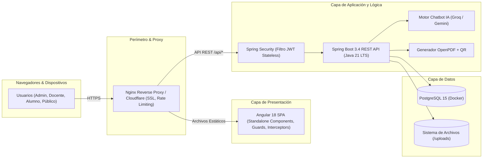
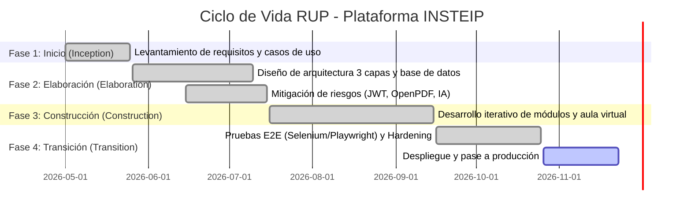
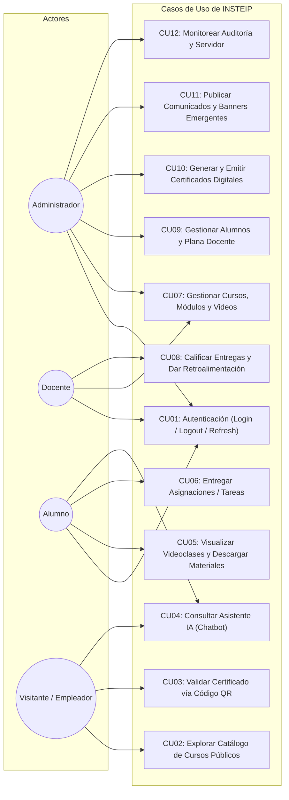
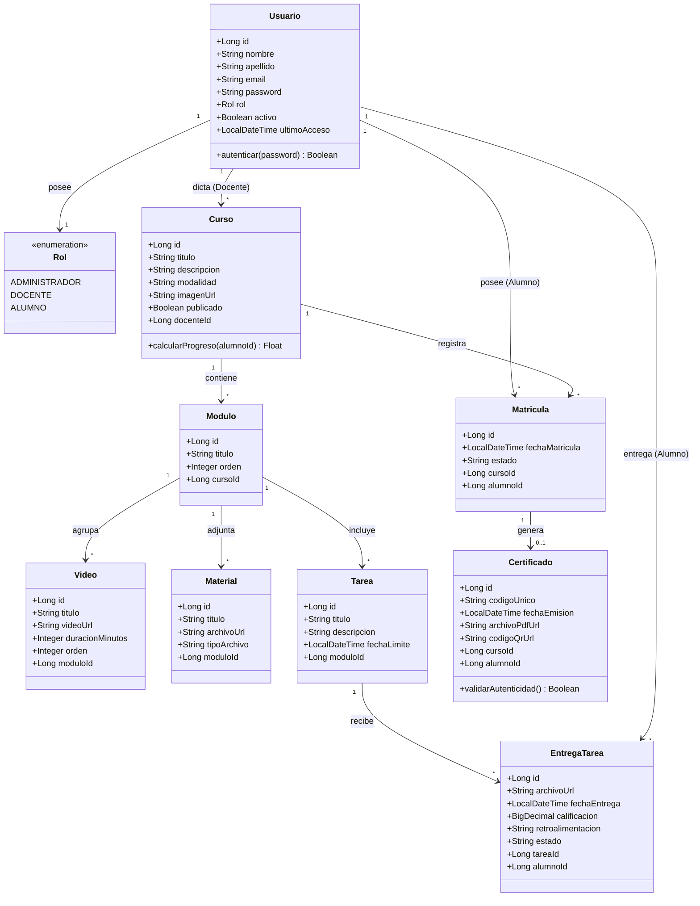
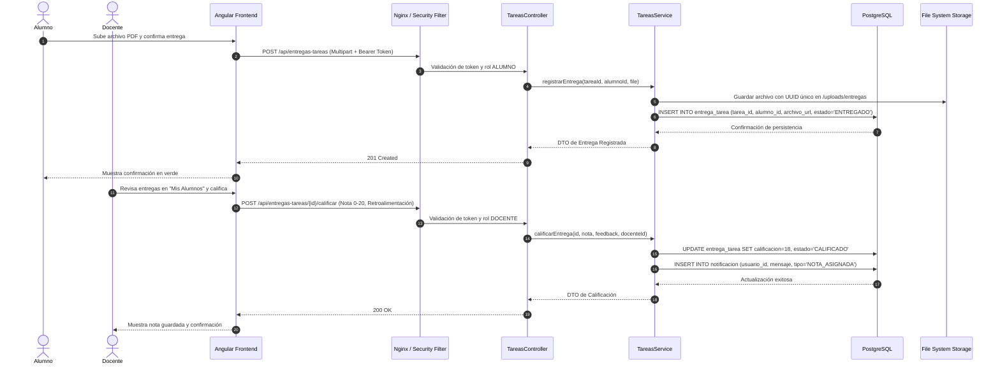
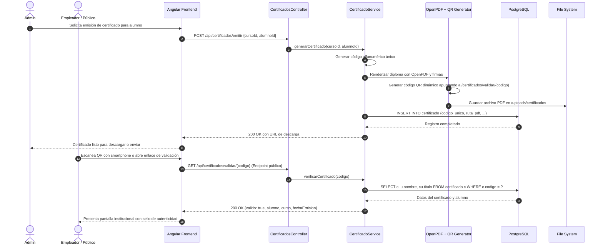

# INSTEIP - Plataforma Integral de Gestión Académica y Campus Virtual

> Plataforma web de gestión académica, campus virtual y certificación digital con validación pública mediante código QR, diseñada para estudiantes, docentes y directivos del Instituto de Terapias Integrales y Orientales (INSTEIP).

<p align="center">
  
</p>

<p align="center">
  
  
  
  
  
  
  
</p>

<p align="center">
  <a href="http://localhost:4200"><strong>🌐 Ver Demo / Acceso Local (Puerto 4200)</strong></a> ·
  <a href="docs/manual.html"><strong>📖 Manual de Usuario Interactivo</strong></a> ·
  <a href="docs/ARCHITECTURE.md"><strong>📐 Documento de Arquitectura</strong></a>
</p>

---

## Qué hace

INSTEIP es una solución integral que digitaliza las actividades académicas y administrativas del **Instituto de Terapias Integrales y Orientales (INSTEIP)**. Cubre tanto los cursos presenciales en sedes (Lima, Huánuco, Piura) como la formación virtual a nivel nacional e internacional.

### Principales Funcionalidades

- **Portal Público y Catálogo Formativo**:
  - Catálogo interactivo de diplomados, cursos y talleres (Acupuntura Tradicional China, Auriculoterapia, Digitopresión Mecánica, Masaje Terapéutico, Electroacupuntura Clínica, Fitoterapia, Dietética y Reflexología).
  - Descarga directa de temarios oficiales en PDF y acceso a la biblioteca digital de libros especializados.
  - Formulario de inscripción y enlace directo de asesoría vía WhatsApp institucional.

- **Campus Virtual y Aula de Aprendizaje (Alumno)**:
  - Consola de estudiante con listado de cursos matriculados y cálculo dinámico de avance porcentual.
  - Reproductor multimedia avanzado de videoclases: control de velocidad, persistencia de segundo visto, pantalla completa y subtítulos (CC).
  - Repositorio de materiales complementarios descargables (guías clínicas, diapositivas y manuales en PDF).

- **Módulo de Tareas y Evaluaciones**:
  - Creación de asignaciones por módulo con fecha y hora límite de entrega.
  - Buzón de entrega para estudiantes con soporte de archivos PDF y Word.
  - Panel de calificación docente sobre escala vigesimal (0 a 20) con retroalimentación cualitativa.

- **Emisión y Validación Pública de Certificados Digitales**:
  - Motor de generación de diplomas en PDF en alta resolución con **OpenPDF**, incluyendo firmas institucionales vectorizadas.
  - Asignación de código alfanumérico único e inmutable y código QR incrustado.
  - Validador público en tiempo real (`/certificados/validar/:codigo`) sin requerir autenticación para que empleadores o pacientes verifiquen la autenticidad al instante.

- **Asistente Virtual Inteligente con IA (Chatbot 24/7)**:
  - Asistente flotante potenciado por LLM (**Llama 3.1 vía Groq / Google Gemini**) con base de conocimiento RAG cargada desde [`infoInsteip.md`](infoInsteip.md).
  - Responde consultas sobre planes de estudio, costos, horarios dominicales, requisitos de matrícula y sedes oficiales.

- **Notificaciones Reactivas y Anuncios Modal (Pop-up)**:
  - Centro de notificaciones dinámicas (campana 🔔 con conteo en tiempo real) ante publicaciones de videos, notas asignadas o comunicados.
  - Módulo de anuncios emergentes en modal para campañas y talleres de temporada con control de frecuencia por usuario (`localStorage`).

- **Consola de Administración y Auditoría Institucional**:
  - Control de usuarios (Alumnos y Docentes): altas, bajas lógicas, reseteo de credenciales y asignación de cursos.
  - Registro de auditoría con bitácora de eventos del sistema, IP de origen y marcas de tiempo.
  - Monitoreo del estado del servidor, uso de disco, backups y métricas operacionales.

---

## Arquitectura (diagrama + enlace a docs/ARCHITECTURE.md)

La plataforma está diseñada bajo una **Arquitectura en Tres Capas (Three-Tier Layered Architecture)** desacoplada, asegurando alta cohesión, bajo acoplamiento y escalabilidad:



> 📄 **Documentación Arquitectónica Completa**:  
> Consulta el desglose exhaustivo de patrones de diseño, decisiones arquitectónicas (ADR), contratos de API y capas en [docs/ARCHITECTURE.md](docs/ARCHITECTURE.md).

---

## Metodología RUP (Rational Unified Process) y Modelado UML

El ciclo de desarrollo y la ingeniería de software del sistema INSTEIP se fundamentan en el proceso unificado **RUP (Rational Unified Process)** y se documentan mediante el estándar **UML (Unified Modeling Language)**.

### Fases del Proceso RUP Aplicadas al Proyecto



1. **Fase de Inicio (Inception)**: Delimitación del alcance con directivos de INSTEIP, especificación de requerimientos de negocio, identificación de actores principales y elaboración del caso de negocio.
2. **Fase de Elaboración (Elaboration)**: Definición de la línea base arquitectónica (Spring Boot 3.4 + Angular 18 + PostgreSQL 15), mitigación de riesgos críticos (seguridad stateless con JWT, motor de certificados con QR y latencia del asistente virtual) y diseño detallado del modelo de datos.
3. **Fase de Construcción (Construction)**: Desarrollo modular iterativo e incremental: módulos de cursos, reproductor de clases, sistema de tareas y calificaciones vigesimales, notificaciones reactivas y panel de auditoría.
4. **Fase de Transición (Transition)**: Validación integral de QA (Selenium, Playwright, JUnit 5), pruebas de carga y regresión, hardening perimetral de Nginx, generación de documentación técnica y despliegue productivo.

---

### Modelos y Diagramas UML

#### 1. Diagrama UML de Casos de Uso del Sistema



#### 2. Diagrama UML de Clases de Entidades del Dominio



#### 3. Diagrama UML de Secuencia: Flujo de Entrega y Calificación de Tareas



#### 4. Diagrama UML de Secuencia: Emisión y Verificación de Certificado con QR



---

## Inicio rápido

### Requisitos Previos

- **Java Development Kit (JDK)**: Versión 21 LTS (o 17+).
- **Node.js**: Versión 20.x o superior con **npm** 10.x+.
- **Docker & Docker Compose**: Para levantar PostgreSQL en contenedor.
- **Git**: Para clonar el repositorio.

---

### Paso a Paso para Levantar el Proyecto

#### 1. Clonar el repositorio
```bash
git clone https://github.com/Alessander9/Insteip.git
cd Insteip
```

#### 2. Configurar variables de entorno
```bash
cp .env.example .env
```
*(Asegúrate de ajustar contraseñas o claves API en `.env` si es necesario).*

#### 3. Levantar la base de datos (PostgreSQL 15)
```bash
docker compose up -d
```
> La base de datos iniciará en el puerto local `5455` y ejecutará automáticamente los esquemas y datos iniciales ubicados en `database/`.

#### 4. Ejecutar el Backend (Spring Boot 3.4)
En Linux / macOS:
```bash
cd backend
./mvnw spring-boot:run
```
En Windows (PowerShell):
```powershell
cd backend
.\mvnw.cmd spring-boot:run
```
> El servicio backend estará disponible en `http://localhost:8081`.

#### 5. Ejecutar el Frontend (Angular 18)
En una nueva terminal:
```bash
cd frontend
npm install
npm start
```
> La aplicación web cargará automáticamente en `http://localhost:4200`.

---

## Configuración (.env.example)

El archivo `.env.example` en la raíz define todos los parámetros de configuración requeridos para el funcionamiento del sistema:

| Variable | Descripción | Valor por Defecto / Ejemplo |
|---|---|---|
| `DB_URL` | Cadena JDBC de conexión a PostgreSQL | `jdbc:postgresql://localhost:5455/insteip_db` |
| `DB_USERNAME` | Usuario de base de datos | `postgres` |
| `DB_PASSWORD` | Contraseña de base de datos | `tu_password_segura` |
| `POSTGRES_USER` | Usuario para el contenedor Docker | `postgres` |
| `POSTGRES_PASSWORD` | Contraseña para el contenedor Docker | `tu_password_segura` |
| `POSTGRES_DB` | Nombre de base de datos en Docker | `insteip_db` |
| `JWT_SECRET` | Clave secreta para firma de tokens HMAC-SHA | `clave_secreta_minimo_256_bits_en_base64` |
| `JWT_EXPIRATION` | Tiempo de vida del Access Token (ms) | `1800000` (30 minutos) |
| `API_BASE_URL` | URL base del backend | `http://localhost:8081` |
| `FRONTEND_BASE_URL` | URL base del frontend para enlaces y CORS | `http://localhost:4200` |
| `STORAGE_PATH` | Directorio local para almacenamiento de archivos | `uploads` |
| `CORS_ALLOWED_ORIGINS` | Orígenes web permitidos separados por comas | `http://localhost:4200,http://127.0.0.1:4200` |
| `SEED_DEFAULT_USERS` | Bandera para insertar usuarios iniciales | `true` o `false` |
| `SEED_ADMIN_EMAIL` | Correo del administrador inicial | `admin@insteip.com` |
| `SEED_ADMIN_PASSWORD` | Contraseña del administrador inicial | `AdminSegura123!` |
| `GROQ_API_KEY` | Llave API de Groq Cloud para el Chatbot | `gsk_...` |
| `GROQ_MODEL` | Modelo de lenguaje de Groq | `llama-3.1-8b-instant` |
| `CHATBOT_CONTEXT_PATH` | Ruta al archivo de conocimiento institucional | `../infoInsteip.md` |
| `GEMINI_API_KEY` | Llave API de Google Gemini (alternativa) | `AIzaSy...` |
| `GEMINI_MODEL` | Modelo de lenguaje de Google Gemini | `gemini-3.5-flash` |

---

## Modelos y datos usados

### Modelo de Datos Relacional

El sistema persiste su estado en una base de datos relacional PostgreSQL 15 estructurada en las siguientes entidades:

- **`usuario`**: Registro de usuarios con credenciales hasheadas (`BCrypt`), rol institucional (`ADMINISTRADOR`, `DOCENTE`, `ALUMNO`), estado de activación y marcas de último acceso.
- **`curso`**: Catálogo de cursos, diplomados y talleres, modalidad (online/presencial), estado de publicación y docente titular.
- **`modulo`**: Unidades temáticas pertenecientes a un curso, con ordenación secuencial.
- **`video`**: Enlaces y referencias a videoclases por módulo, duración en minutos y orden de visualización.
- **`material`**: Documentos adjuntos descargables (PDFs, guías de estudio) asociados a cada módulo.
- **`tarea`**: Asignaciones académicas con descripción y fecha límite de entrega.
- **`entrega_tarea`**: Subida de archivos de tareas por alumnos, calificación numérica (0-20), fecha de envío y retroalimentación docente.
- **`matricula`**: Registro de suscripción o matrícula del alumno en un curso con estado (`ACTIVA`, `FINALIZADA`).
- **`avance`**: Seguimiento de videos completados y porcentaje de progreso del alumno.
- **`certificado`**: Diplomas oficiales emitidos con código único criptográfico, URL del PDF generado y fecha de expedición.
- **`notificacion`**: Mensajes y avisos individuales generados por eventos del sistema.
- **`anuncio_modal`**: Campañas promocionales emergentes en modal para difusión de talleres.
- **`auditoria`**: Bitácora de accesos, intentos de login, cambios críticos y eventos administrativos.

### Datos Institucionales y Base de Conocimiento (RAG)

- **[`infoInsteip.md`](infoInsteip.md)**: Archivo estructurado con la información oficial de la institución:
  - Oferta académica completa y costos mensuales / por taller.
  - Horarios de clases presenciales (Lince) y modalidad virtual 24/7.
  - Métodos de pago oficiales (Yape, Plin, transferencias bancarias BCP/BBVA).
  - Canales de atención y contacto oficial por WhatsApp (+51 930 830 427).
  - Sedes físicas (Sede Central Lima, Huánuco, Piura).
  - Esta información alimenta contextualmente al motor del Asistente Virtual para evitar alucinaciones.

---

## Evaluación y resultados

El sistema ha sido sometido a exhaustivas campañas de control de calidad y aseguramiento de software:

| Nivel de Prueba | Herramienta | Alcance / Cobertura | Estado |
|---|---|---|---|
| **Pruebas Unitarias Backend** | JUnit 5 + Mockito | Controladores REST, servicios de negocio, validaciones y lógica de cálculo de avance | ✅ 100% Pasadas |
| **Pruebas de Integración** | Spring Boot Test (`@WebMvcTest`) | Flujos de autenticación JWT, seguridad de endpoints, serialización DTO | ✅ 100% Pasadas |
| **Pruebas de Componentes Frontend** | Jasmine + Karma | Componentes Standalone, interceptores HTTP, guards de ruta y servicios | ✅ 100% Pasadas |
| **Pruebas E2E Funcionales** | Selenium WebDriver | Flujo completo de login, navegación en catálogo, reproducción de clases y entrega de tareas | ✅ 100% Pasadas |
| **Pruebas E2E Visuales y Regresión** | Playwright | Renderizado de vistas, validación responsive en móviles y escritorio, formularios | ✅ 100% Pasadas |
| **Validación de Certificados** | Automated Script | Verificación de generación de QR, legibilidad de PDFs y validación de hash público | ✅ 100% Pasadas |

### Métricas de Rendimiento Registradas
- **Tiempo de Respuesta de API**: Latencia promedio menor a **45 ms** en consultas de catálogo y menor a **90 ms** en operaciones transaccionales.
- **Tiempo de Inferencia del Chatbot**: Respuesta promedio en **~1.2 segundos** utilizando la API de alta velocidad de Groq (`llama-3.1-8b-instant`).
- **Validación Pública de Certificado**: Menos de **50 ms** para verificar autenticidad por código QR.

---

## Seguridad y limitaciones conocidas

### Medidas de Seguridad Implementadas

- **Autenticación Stateless con JWT y Refresh Token**:
  - Tokens firmados mediante algoritmo HMAC-SHA256 con tiempo de vida corto (30 minutos).
  - Renovación controlada mediante Refresh Tokens seguros.
- **Cifrado de Credenciales**:
  - Contraseñas almacenadas exclusivamente mediante hash `BCrypt` con factor de coste balanceado.
- **Control de Acceso Basado en Roles (RBAC)**:
  - Autorización declarativa en backend con `@PreAuthorize` en cada endpoint.
  - Protección de navegación en frontend mediante `canActivate` Guards (`AuthGuard`, `RoleGuard`).
- **Defensa contra Ataques de Fuerza Bruta**:
  - Bloqueo temporal de cuentas tras múltiples intentos fallidos continuos de autenticación.
- **Validación Estricta de Entradas y Carga de Archivos**:
  - Validación declarativa de DTOs con `jakarta.validation`.
  - Verificación de tipos MIME, extensiones permitidas y renombrado con UUID de archivos subidos para prevenir Path Traversal y ejecución remota de código.
- **Blindaje Perimetral Nginx**:
  - Encabezados de seguridad reforzados (`X-Frame-Options: SAMEORIGIN`, `X-Content-Type-Options: nosniff`, `Strict-Transport-Security`, `Content-Security-Policy`).
  - Límite de tasa de peticiones (*rate limiting*) para mitigar ataques DoS.

### Limitaciones Conocidas

- **Cuota de Tokens en LLM Externo**: En caso de saturación o agotamiento de la cuota del proveedor de IA (Groq), el sistema debe recurrir al proveedor de respaldo configurado (Gemini / OpenRouter).
- **Almacenamiento Local de Archivos**: Las entregas y certificados se almacenan en el sistema de archivos del servidor montado en Docker (`uploads/`). Para un despliegue multi-instancia en clúster horizontal, se requeriría migrar a almacenamiento de objetos compatible con S3 (MinIO / AWS S3).
- **Incrustación de Videos**: Para proteger el ancho de banda del servidor, las videoclases se integran mediante enlaces embebidos de plataformas externas especializadas (YouTube no listado / Vimeo).

---

## Costos y rendimiento

### Estimación de Costos de Infraestructura y Operación

El diseño de INSTEIP prioriza un balance óptimo entre alta eficiencia y mínimos costos de infraestructura:

| Componente | Proveedor / Servicio Sugerido | Especificaciones | Costo Mensual Estimado |
|---|---|---|---|
| **Servidor VPS** | IONOS / Contabo / Hetzner | 2-4 vCPU, 4-8 GB RAM, 100 GB NVMe | ~$5.00 a $12.00 USD |
| **Base de Datos** | PostgreSQL 15 en Docker | Alojada en el mismo VPS con volumen dedicado | $0.00 USD adicionales |
| **DNS, SSL & WAF** | Cloudflare | Nivel Gratuito (SSL automático, CDN, mitigación DDoS) | $0.00 USD |
| **Inferencia Chatbot** | Groq Cloud / Google Gemini | Plan Gratuito (Tier gratuito para Llama 3.1 / Gemini) | $0.00 a $1.00 USD |
| **Almacenamiento** | Disco NVMe local | Incluido en el VPS | $0.00 USD |
| **Dominio Institucional** | Registrador DNS (.com / .pe) | Registro anual prorrateado | ~$1.00 USD / mes |
| **Total Estimado** | — | **Operación mensual completa** | **~$6.00 a $14.00 USD / mes** |

### Métricas de Rendimiento y Uso de Recursos
- **Frontend SPA**: Peso transferido inicial menor a **850 KB** (con compresión Brotli/Gzip activada en Nginx).
- **Consumo de Memoria Backend**: La JVM de Spring Boot opera con estabilidad en un rango de **~350 MB a 550 MB** de memoria RAM en condiciones de tráfico habitual.
- **Rendimiento de Base de Datos**: Pool de conexiones gestionado por **HikariCP** con capacidad para atender más de 250 peticiones concurrentes por segundo sin degradación.

---

## Estructura del proyecto

El repositorio está organizado como un monorepo modular con separación estricta de responsabilidades:

```text
INSTEIP/
├── backend/                             # API REST Spring Boot 3.4 (Java 21)
│   ├── src/main/java/com/insteip/
│   │   ├── controller/                  # Endpoints REST públicos y privados
│   │   ├── service/                     # Lógica de negocio e interfaces
│   │   ├── repository/                  # Repositorios Spring Data JPA
│   │   ├── domain/
│   │   │   ├── entity/                  # Entidades JPA (Usuario, Curso, Tarea, etc.)
│   │   │   ├── dto/                     # Data Transfer Objects organizados por dominio
│   │   │   └── exception/               # Manejo centralizado de excepciones
│   │   └── infrastructure/
│   │       ├── security/                # Filtros JWT, UserDetailsService, AuthProvider
│   │       ├── config/                  # CORS, OpenAPI, WebConfig, Seeders
│   │       └── util/                    # Generador de certificados OpenPDF y QR
│   ├── src/main/resources/
│   │   ├── application.properties       # Configuración principal de Spring
│   │   └── db/                          # Scripts de migración SQL
│   └── pom.xml                          # Dependencias Maven
│
├── frontend/                            # Aplicación Angular 18 (Standalone Components)
│   ├── src/app/
│   │   ├── core/                        # Núcleo reutilizable de la aplicación
│   │   │   ├── models/                  # Interfaces TypeScript de datos
│   │   │   ├── services/                # Servicios HTTP y reactivos (Auth, Curso, etc.)
│   │   │   ├── guards/                  # AuthGuard y RoleGuard
│   │   │   ├── interceptors/            # AuthInterceptor (inyección de JWT)
│   │   │   └── components/              # Navbar, Footer, Modales, Toast
│   │   └── features/                    # Módulos de negocio y vistas
│   │       ├── inicio/                  # Landing page institucional
│   │       ├── auth/login/              # Login y recuperación de cuenta
│   │       ├── cursos/                  # Catálogo público y detalle de cursos
│   │       ├── validar-certificado/     # Verificación pública vía QR
│   │       └── dashboard/               # Paneles privados (Admin, Docente, Alumno)
│   ├── tailwind.config.js               # Configuración de estilos TailwindCSS
│   └── tsconfig.json                    # Path aliases (@core/*, @features/*, @env/*)
│
├── database/                            # Scripts SQL de inicialización
│   ├── schema.sql                       # Esquema DDL de tablas y llaves foráneas
│   ├── seed.sql                         # Datos iniciales y usuarios semilla
│   └── seed_dia_acupuntura.sql          # Datos para eventos y talleres especiales
│
├── docs/                                # Documentación técnica y manuales
│   ├── ARCHITECTURE.md                  # Especificación de arquitectura y patrones
│   ├── QA_TOTAL_SISTEMA.md              # Matriz de aseguramiento de calidad
│   ├── QA_UNIFICADO.md                  # Plan de pruebas unificado
│   ├── GUIA_DEPLOY_IONOS.md             # Guía de despliegue en servidor VPS
│   ├── manual.html                      # Manual interactivo de usuario
│   └── Manual_de_Usuario_INSTEIP.pdf    # Manual de usuario en formato PDF
│
├── scripts/                             # Automatizaciones y suites de pruebas
│   ├── tests/e2e/                       # Scripts de prueba con Selenium y Playwright
│   ├── deploy-setup.sh                  # Script de aprovisionamiento inicial en VPS
│   └── deploy-update.sh                 # Script de despliegue continuo y actualización
│
├── docker-compose.yml                   # Orquestación de PostgreSQL 15
├── .env.example                         # Plantilla de variables de entorno
├── infoInsteip.md                       # Base de conocimiento institucional para IA
└── README.md                            # Documentación global del proyecto
```

---

## Tests

El proyecto cuenta con suites de prueba automatizadas para todos los niveles de la pirámide de pruebas:

### Ejecutar Pruebas del Backend (JUnit 5 + Mockito)
```bash
cd backend
./mvnw test
```
En Windows:
```powershell
cd backend
.\mvnw.cmd test
```

### Ejecutar Pruebas del Frontend (Karma + Jasmine)
```bash
cd frontend
npm test
```

### Ejecutar Pruebas End-to-End (E2E) con Selenium
Asegúrate de que el frontend y el backend estén corriendo localmente:
```bash
# Smoke test rápido de interfaz
node scripts/tests/e2e/selenium-test.js

# Suite integral completa de roles y flujos
node scripts/tests/e2e/selenium-super-test.js
```

### Ejecutar Pruebas Visuales con Playwright
```bash
node scripts/tests/e2e/super-test.js
```

---

## Documentación adicional

- 📐 [Documento de Arquitectura y Patrones (docs/ARCHITECTURE.md)](docs/ARCHITECTURE.md)
- 🧪 [Matriz de QA Total del Sistema (docs/QA_TOTAL_SISTEMA.md)](docs/QA_TOTAL_SISTEMA.md)
- 📋 [Guía de QA Unificado (docs/QA_UNIFICADO.md)](docs/QA_UNIFICADO.md)
- 🚀 [Guía de Despliegue en Servidores IONOS (docs/GUIA_DEPLOY_IONOS.md)](docs/GUIA_DEPLOY_IONOS.md)
- 🖥️ [Estado de Despliegue en Servidores (docs/estado_deploy_contabo_donweb.md)](docs/estado_deploy_contabo_donweb.md)
- 📖 [Manual de Usuario en HTML (docs/manual.html)](docs/manual.html)
- 📄 [Manual de Usuario en PDF (docs/Manual_de_Usuario_INSTEIP.pdf)](docs/Manual_de_Usuario_INSTEIP.pdf)
- 🌿 [Información Académica y Base de Conocimiento (infoInsteip.md)](infoInsteip.md)

---

## Contribuir · Licencia · Contacto

### Cómo Contribuir

1. Realiza un Fork del repositorio o crea una rama de trabajo a partir de `develop`:
   ```bash
   git checkout -b feature/nombre-de-la-funcionalidad
   ```
2. Realiza cambios asegurando que las pruebas existentes pasen (`./mvnw test` y `npm test`).
3. Sigue el estándar de **Conventional Commits**:
   - `feat(...)`: Nueva funcionalidad.
   - `fix(...)`: Corrección de errores.
   - `docs(...)`: Actualizaciones de documentación.
   - `refactor(...)`: Mejora de código sin alterar comportamiento.
4. Abre un Pull Request describiendo detalladamente los cambios y las pruebas realizadas.

---

### Licencia

Este software y su código fuente son de carácter **Propietario y Privado**.  
Todos los derechos están reservados por el **Instituto de Terapias Integrales y Orientales (INSTEIP)** y su equipo de desarrollo principal.  
Queda terminantemente prohibida la copia, reproducción, distribución, comercialización o modificación total o parcial sin la previa autorización por escrito de los titulares de los derechos de autor.

---

### Canales de Contacto Oficiales

- 💬 **WhatsApp Central de Atención**: [+51 930 830 427](https://wa.me/51930830427?text=Hola%20Insteip%2C%20deseo%20m%C3%A1s%20informaci%C3%B3n)
- 💬 **Coordinación Sede Huánuco**: [+51 935 354 183](https://wa.me/51935354183?text=Hola%20Insteip%2C%20contacto%20Huanuco)
- 📧 **Correo Electrónico**: `Terapiasintegralesinsteip@gmail.com`
- 📍 **Sede Principal (Lima)**: [Av. Julio C. Tello 438, Lince, Lima, Perú](https://maps.google.com/?q=Av.+Julio+C.+Tello+438,+Lince,+Lima,+Perú)
- 🌐 **Redes Sociales**:
  - TikTok: [@terapias.integrales](https://www.tiktok.com/@terapias.integrales)
  - Instagram: [@institutodeterapias](https://www.instagram.com/institutodeterapias/?hl=es%20insteip)
  - Facebook: [fb.com/insteip](https://www.facebook.com/insteip)
  - YouTube: [@insteipperucursosterapiasc4318](https://www.youtube.com/@insteipperucursosterapiasc4318)
