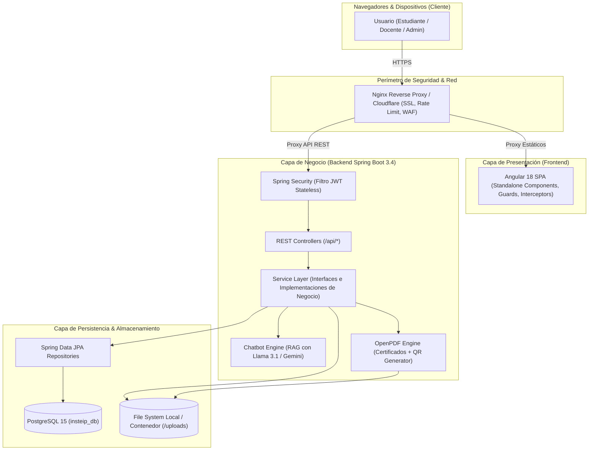
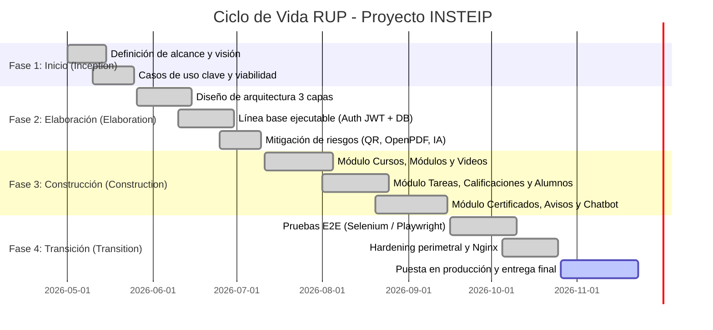
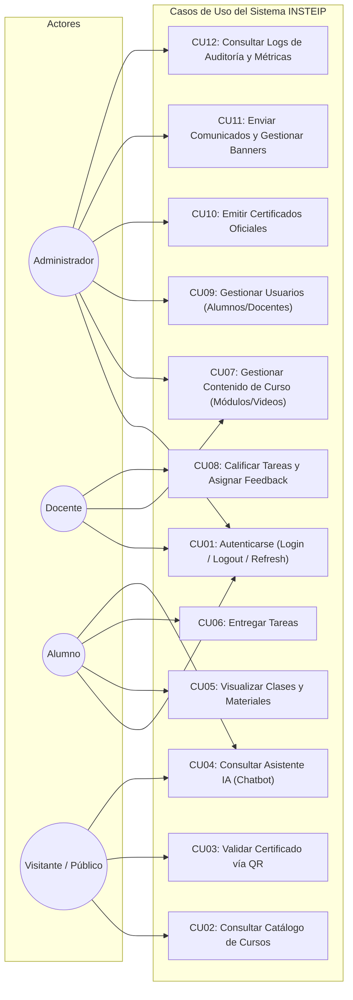
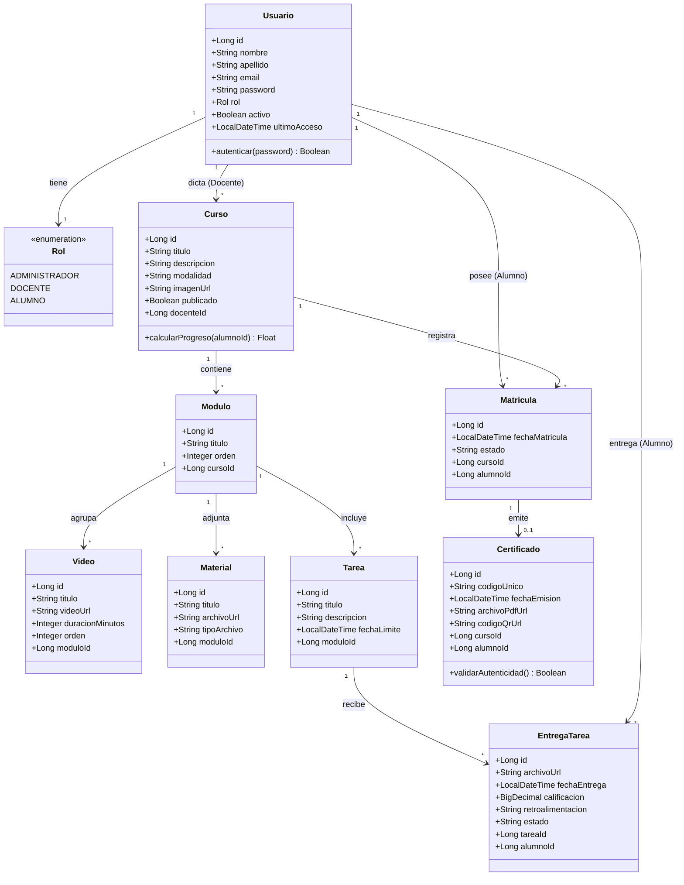
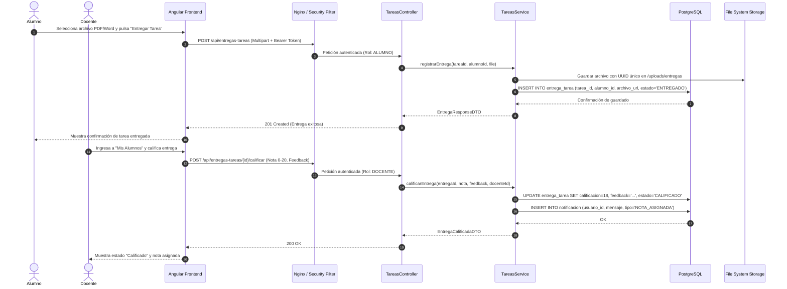
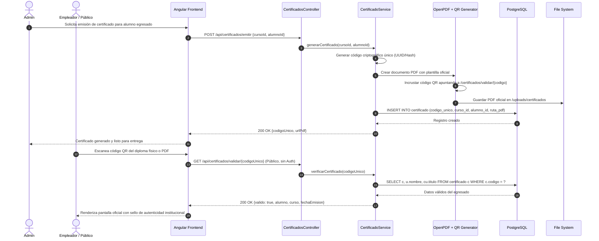

# Arquitectura del Sistema - INSTEIP

Este documento describe la arquitectura técnica, los patrones de diseño, el marco metodológico **RUP (Rational Unified Process)** y los modelos **UML (Unified Modeling Language)** que sustentan la plataforma académica y campus virtual **INSTEIP**.

---

## 1. Visión General y Estilo Arquitectónico

INSTEIP adopta una **Arquitectura en Tres Capas (Three-Tier Layered Architecture)** desacoplada y orientada a servicios RESTful:

1. **Capa de Presentación (Frontend SPA)**: Desarrollada en **Angular 18** con componentes Standalone, TypeScript, TailwindCSS y RxJS. Consume la API de forma asíncrona mediante HTTP interceptors con inyección automática de tokens JWT.
2. **Capa de Negocio y Aplicación (Backend API)**: Implementada sobre **Spring Boot 3.4** y **Java 21 LTS**, aplicando principios SOLID, inyección de dependencias, Spring Security con arquitectura Stateless (JWT), validación declarativa de datos y orquestación de servicios.
3. **Capa de Datos y Persistencia**: Motor relacional **PostgreSQL 15** administrado mediante Spring Data JPA y Hibernate 6, con scripts SQL de migración y volumen persistente en contenedor Docker.



---

## 2. Marco Metodológico RUP (Rational Unified Process)

El desarrollo del sistema INSTEIP sigue la metodología **RUP**, caracterizada por ser:
- **Dirigida por Casos de Uso**: Las necesidades de los alumnos, docentes y administradores guían el diseño, desarrollo y pruebas.
- **Centrada en la Arquitectura**: La estructura en tres capas y el esquema de seguridad fueron priorizados tempranamente para garantizar escalabilidad y robustez.
- **Iterativa e Incremental**: El ciclo de vida se organizó en 4 fases secuenciales con iteraciones controladas y entregables verificables.

### 2.1. Fases del Proceso RUP en INSTEIP



1. **Fase de Inicio (Inception)**:
   - Identificación de los interesados (Directivos de INSTEIP, docentes de medicina tradicional china/terapias integrales y estudiantes).
   - Definición de requisitos funcionales (gestión de matrículas, cursos online/presenciales, emisión de certificados con QR).
   - Evaluación de viabilidad técnica y estimación de costos operacionales mínimos.

2. **Fase de Elaboración (Elaboration)**:
   - Establecimiento de la línea base arquitectónica (Spring Boot 3.4 + Angular 18 + PostgreSQL).
   - Modelado formal de casos de uso y diagrama de dominio entidad-relación.
   - Resolución de riesgos arquitectónicos: seguridad stateless con JWT, motor de certificados en PDF y latencia del asistente virtual LLM.

3. **Fase de Construcción (Construction)**:
   - Desarrollo iterativo de componentes frontend desacoplados y servicios REST backend.
   - Implementación del sistema de tareas vigesimal (0-20), streaming/reproductor de clases, notificaciones en tiempo real y módulo de auditoría.
   - Refactorización a componentes Standalone en Angular y servicios modulares en Spring Boot.

4. **Fase de Transición (Transition)**:
   - Pruebas integrales de QA automatizadas (suites unitarias con JUnit 5/Mockito y E2E con Selenium WebDriver y Playwright).
   - Despliegue en contenedor Docker y configuración del servidor web Nginx con cabeceras HTTP seguras y compresión Gzip.
   - Generación de manuales técnicos, guías de usuario y auditoría final previa a despliegue.

---

## 3. Modelado UML (Unified Modeling Language)

### 3.1. Diagrama UML de Casos de Uso del Sistema



### 3.2. Diagrama UML de Clases del Dominio



### 3.3. Diagrama UML de Secuencia: Entrega y Calificación de Tareas



### 3.4. Diagrama UML de Secuencia: Emisión y Validación Pública de Certificado con QR



### 3.5. Diagrama UML de Despliegue Físico y Componentes

```mermaid
deploymentDiagram
    node "Cliente Web" {
        artifact "Navegador Web (Chrome/Firefox/Safari)" as Browser
    }

    node "Servidor Cloud / VPS (Ubuntu Server 22.04 LTS)" {
        node "Nginx Web Server" {
            artifact "Reverse Proxy & Static Asset Cache" as NginxProxy
            artifact "Frontend Angular Build (/var/www/insteip)" as AngularDist
        }

        node "Docker Engine" {
            node "Contenedor: insteip-backend" {
                artifact "Spring Boot 3.4 Executable (JAR, OpenJDK 21)" as BackendJar
            }

            node "Contenedor: insteip-postgres" {
                database "PostgreSQL 15 (Puerto interno 5432)" as PostgresData
            }

            node "Host Persistent Volumes" {
                folder "/var/lib/docker/volumes/postgres_data" as DBVolume
                folder "/var/insteip/uploads" as UploadsVolume
            }
        }
    }

    node "Servicios Externos en la Nube" {
        cloud "Groq Cloud API (Llama 3.1 8B Instant)" as GroqAPI
        cloud "Google Gemini API (Gemini 3.5 Flash)" as GeminiAPI
        cloud "Cloudflare DNS / CDN / SSL" as Cloudflare
    }

    Browser --> Cloudflare : HTTPS (Puerto 443)
    Cloudflare --> NginxProxy : Tráfico seguro filtrado
    NginxProxy --> AngularDist : Entrega SPA estática
    NginxProxy --> BackendJar : Proxy inverso REST (Puerto 8081)
    BackendJar --> PostgresData : JDBC Connection Pool (HikariCP)
    BackendJar --> UploadsVolume : Lectura y escritura de PDFs/Imágenes
    PostgresData --> DBVolume : Persistencia física de transacciones
    BackendJar ..> GroqAPI : Inferencia LLM Chatbot (HTTPS REST)
    BackendJar ..> GeminiAPI : Fallback Chatbot (HTTPS REST)
```

---

## 4. Patrones de Diseño Aplicados

- **Arquitectura Limpia / Capas**: Desacoplamiento estricto entre controladores REST, interfaces de servicio, repositorios JPA y entidades de dominio.
- **DTO (Data Transfer Object)**: Encapsulamiento de entradas y respuestas de API para prevenir sobreexposición de entidades y ataques de asignación masiva (Mass Assignment).
- **Inversión de Dependencias (Dependency Injection)**: Uso intensivo de `@Autowired` / inyección por constructor para favorecer la testabilidad con Mockito.
- **Interceptor Pattern**: Interceptores HTTP en Angular para adjuntar el encabezado `Authorization: Bearer <token>` de forma transparente a cada petición.
- **Guard Pattern (Angular Routing)**: `AuthGuard` y `RoleGuard` que evalúan permisos antes de permitir la navegación a vistas del dashboard.
- **Factory / Strategy Pattern**: Adaptadores para el Asistente Virtual que permiten alternar entre proveedores LLM (Groq Llama 3.1, Gemini o fallback OpenRouter) sin alterar el código cliente.

---

## 5. Decisiones Arquitectónicas Clave (ADR Summary)

1. **Autenticación Stateless JWT**: Se eligió JWT sobre sesiones con estado en servidor para reducir el consumo de memoria en el backend y permitir alta concurrencia sin replicación de sesiones.
2. **Angular Standalone Components**: Se adoptó la arquitectura moderna de Angular sin `NgModule` para reducir el tamaño del bundle, acelerar el tiempo de compilación y optimizar la carga diferida (*lazy loading*).
3. **OpenPDF para Certificados**: Generación en servidor de PDFs de alta fidelidad visual con vectorización de firmas y códigos QR dinámicos, garantizando inmutabilidad.
4. **Docker Compose para Base de Datos**: Aislamiento del motor PostgreSQL 15 con volumen dedicado para facilitar despliegues reproducibles tanto en desarrollo local como en producción.
